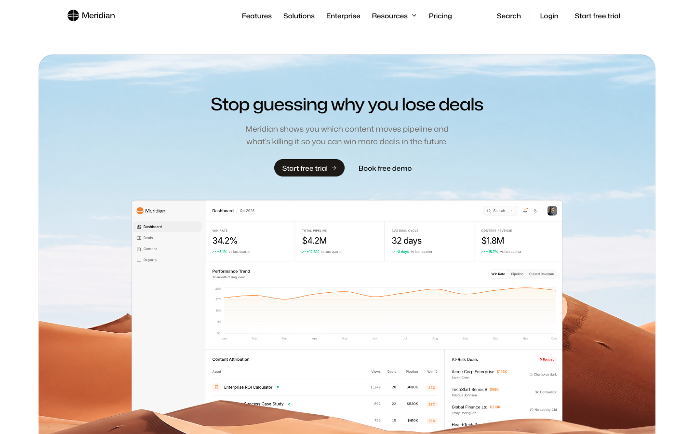
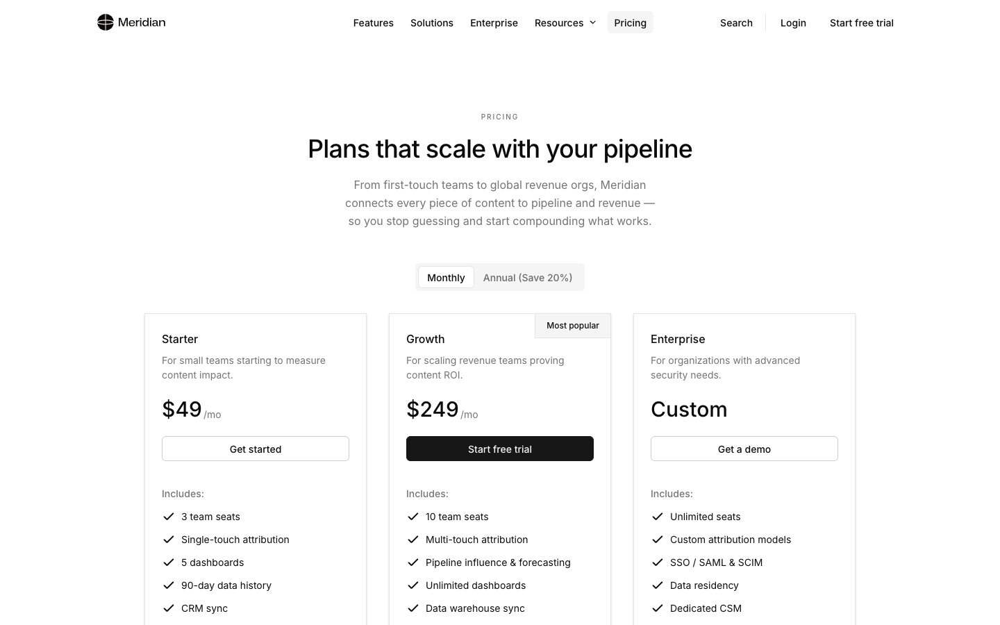
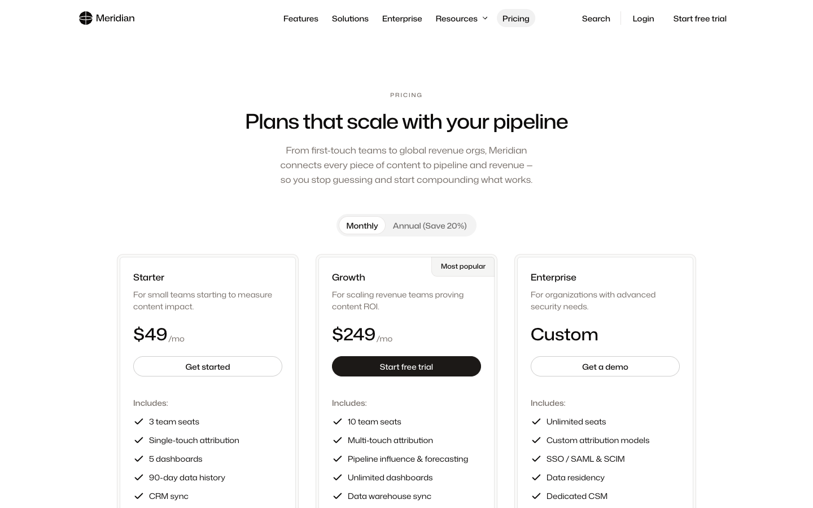
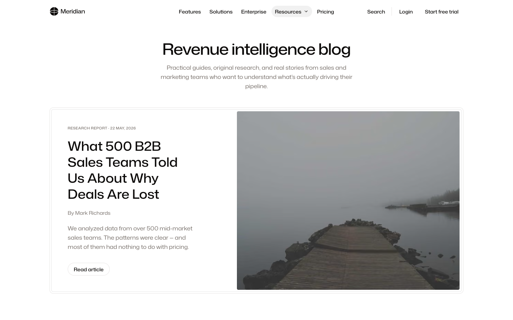

# Nexity

Nexity is a Next.js 16 and Sanity starter for marketing sites. Each starter is a pnpm monorepo with two packages:

- **`web/`**: the Next.js 16 app (App Router, Tailwind CSS 4, TypeScript), with the Sanity Studio embedded at `/admin`.
- **`studio/`**: a standalone Sanity Studio with the same schemas. Schemas live here and `web/` imports them.

This repository holds two starters and, in `.agents/`, the agent layer that works with them: skills and read-only agents (reviewers, auditors) for any coding agent (Claude Code, Codex, Cursor and others).

## Stack

| | Version |
|---|---|
| Next.js | 16.4 (App Router, Turbopack) |
| React | 19.3 |
| Sanity Studio | 6.20 (`next-sanity` 13.3, `@sanity/client` 8.11) |
| Tailwind CSS | 4.3, with shadcn/ui |
| TypeScript | 7.0 |
| Zod | 4.6 |
| Oxlint / Oxfmt | 1.89 / 0.74 |
| c15t (cookie consent) | 3.1 (`@c15t/nextjs`) |
| Resend | 6.34 |
| Node.js | 22.12 or newer |
| pnpm | 12.15 |

Versions are the minimums in each starter's `package.json`; both starters use the same ones.

## Start here

| Entry | What you get | How to start |
|---|---|---|
| [`base/`](base/) | Unbranded starter. Same features as Meridian, neutral look (default Tailwind palette, Inter). Starts on an empty dataset and shows a **Next steps** screen until you add the first content. | `npm create sanity@latest -- --template Pagepro/nexity/base` |
| [`theme-meridian/`](theme-meridian/) | Demo site for Meridian, a fictional B2B brand: full design, product mocks and seed content. | `npm create sanity@latest -- --template Pagepro/nexity/theme-meridian`, then `pnpm seed` |
| [`.agents/`](.agents/) | Agent skills and read-only agents for setting up a project, creating sections, fixing links, writing alt texts and auditing Sanity use. | Copy or symlink into your project's `.agents/` (see [Agent layer](#agent-layer)) |

`sanity init` creates or picks a Sanity project and dataset, downloads the starter folder, writes `web/.env.local` and `studio/.env` with the project id and dataset, creates the API tokens, adds the localhost CORS origins and installs the dependencies. Then:

```bash
pnpm dev     # http://localhost:3000 (site) and http://localhost:3000/admin (Studio)
```

Locally, the standalone Studio at http://localhost:3333 (also started by `pnpm dev`) reloads faster than `/admin`. Production serves only the Studio embedded at `/admin`.

In `theme-meridian/`, run `pnpm seed` to import the Meridian dataset (pages, posts, case studies, images) into the dataset you picked. The seed replaces documents with the same IDs, so use a fresh dataset.

Each starter has its own `README.md` and `docs/` with setup details, environment variables and deployment notes.

## Screenshots

| `base` | `theme-meridian` |
|---|---|
|  |  |
|  |  |
|  |  |

## Features

Both starters have the same features. They differ only in look and seed content. The full list for editors and marketers is in each starter's `docs/FEATURES.md`.

- **Page builder**: about two dozen ready-made blocks (hero, feature grids, bento grid, split sections, stats, pricing, comparison table, testimonials, FAQ, contact form, CTA, listings and more). Each block has shared options: visibility, light/dark theme, dividers and an anchor ID.
- **Content types**: pages, blog, case studies, podcast episodes, reusable libraries (authors, testimonials, integrations), shared sections, global sections injected across URL areas, header, footer and site settings.
- **Editing**: Studio at `/admin` on the same domain, click-to-edit visual preview, live draft preview, tag-based revalidation on publish (no rebuilds), and a Sections Gallery with sample content for every block.
- **Redirects and rewrites** managed in the CMS, live about two minutes after publishing, with patterns, query-string passthrough and loop protection.
- **SEO**: per-page title, description, share image, noindex/nofollow, canonical and hreflang; generated share images; XML sitemap; `robots.txt` with a single `IS_INDEXABLE` launch switch; schema.org JSON-LD; pre-launch GROQ checks for missing or out-of-range titles and descriptions (`docs/guides/before-release.md`).
- **Content for AI agents**: `llms.txt`, and every page as Markdown (add `.md` to any URL).
- **Site basics**: GDPR cookie consent (c15t), Google Tag Manager by env var, a contact form sent through Resend, image optimization through the Sanity CDN, a PWA manifest.
- **Infrastructure as code**: `sanity.blueprint.ts` sets up CORS origins and the revalidation webhook from env vars.
- **Tooling**: TypeScript, Sanity TypeGen, Zod-validated env vars, Oxlint and Oxfmt.
- **Agent layer**: `AGENTS.md` (how to build), `DESIGN.md` (how it looks) and `BRAND.md` (what it says) give any coding agent the project's rules, plus skills and read-only agents in `.agents/`. See [Agent layer](#agent-layer).

## Agent layer

Every coding agent working on a Nexity project reads the same files. Nothing in them is tied to one vendor.

| File | Role | Read by |
|---|---|---|
| `AGENTS.md` (root, `web/`, `studio/`) | How to build: architecture, commands, conventions, the step-by-step checklists | Codex, Cursor and most agents natively; Claude Code through `CLAUDE.md`, a one-line `@AGENTS.md` import |
| `DESIGN.md` | How it looks: tokens in the frontmatter, then section anatomy and do's and don'ts | Every skill that touches what a visitor sees, and `styling-fidelity-reviewer` |
| `BRAND.md` | What it says (a filled-in example in Meridian, a template in `base`): audience, voice, messaging, the invented world of names and numbers | `create-section`, `project-setup`, `generate-alts`, `product-mock` |
| `.agents/skills/<name>/SKILL.md` | Repeatable workflows (set up a project, create a section, fix links, write alts, audit Sanity use) in the open Agent Skills format | Codex from `.agents/skills/`; Claude Code from `.claude/skills/`, a symlink to it |
| `.agents/agents/<name>.md` | Read-only reviewers and auditors with a fixed checklist and output format | Claude Code as subagents (`.claude/agents/` symlink); any other agent reads the file and walks the checklist |

In this repository the symlinks are already in place, so Claude Code and Codex both pick up the skills when you open it. The skills and agents are plain files, not a plugin, and `sanity init --template` does not bring them along, so copy or symlink the ones you want into your project. Keep `.agents/` as the one copy and point Claude Code at it with two relative symlinks:

```bash
# without a clone: fetch one skill, or all agents
npx degit Pagepro/nexity/.agents/skills/create-section .agents/skills/create-section
npx degit Pagepro/nexity/.agents/agents .agents/agents

# from your project root, with this repository cloned next to it
mkdir -p .agents/skills .agents/agents

# copy a skill
cp -R ../nexity/.agents/skills/create-section .agents/skills/

# or symlink it, so it follows updates to the clone
ln -s "$(realpath ../nexity/.agents/skills/create-section)" .agents/skills/create-section

# agents used by the skills
cp ../nexity/.agents/agents/*.md .agents/agents/

# Claude Code reads .claude/; point it at the same files
mkdir -p .claude && ln -s ../.agents/skills .claude/skills && ln -s ../.agents/agents .claude/agents
```

- Building a site: `project-setup`, `create-section`, `sanity-module-catalog`, `pr-writeup`, `work-humanizer`, `product-mock`. `product-mock` works only in `theme-meridian`. `pr-writeup` needs `work-humanizer` next to it.
- Maintaining a site: `link-fix`, `generate-alts`, `sanity-optimizations`.
- For marketers, in this repository only (any site and any CMS, read-only by default, not in the starters): `source-review`, `brand-kit`, `blog-post-quality-review`, `internal-links`, `blog-post-update` (needs `blog-post-quality-review`, `source-review` and `work-humanizer` next to it). They install as the Claude Code plugin `marketing-skills` (`/plugin marketplace add Pagepro/nexity`, then `/plugin install marketing-skills@nexity`) or with `npx skills add Pagepro/nexity`; `marketing-setup` then walks a marketer through the rest. Start from [`MARKETING-SKILLS-README.md`](MARKETING-SKILLS-README.md).
- Agents in `.agents/agents/`: the reviewers `content-model-architect`, `styling-fidelity-reviewer`, `sanity-schema-reviewer` and `groq-parity-reviewer` (run by `create-section`) and `link-reviewer` (run by `link-fix` and `create-section`); the auditors `sanity-query-auditor`, `sanity-image-auditor` and `sanity-delivery-auditor` (run by `sanity-optimizations`); and `alt-text-writer` (run by `generate-alts`).
- `work-humanizer` comes from [phuryn/work-humanizer](https://github.com/phuryn/work-humanizer) (MIT, license file kept in the skill folder).

[`.agents/README.md`](.agents/README.md) describes each skill and agent; `docs/guides/skills.md` in either starter covers installing them.

## Requirements

- Node.js 22.12 or newer (see `.nvmrc` in each starter)
- pnpm 12.15 (pinned in each starter's `packageManager` field; `corepack enable` picks it up)
- A Sanity account (free plan works)

## Contributing

See [CONTRIBUTING.md](CONTRIBUTING.md). To report a vulnerability, see [SECURITY.md](SECURITY.md).

## License

[MIT](LICENSE) © 2026 Pagepro
